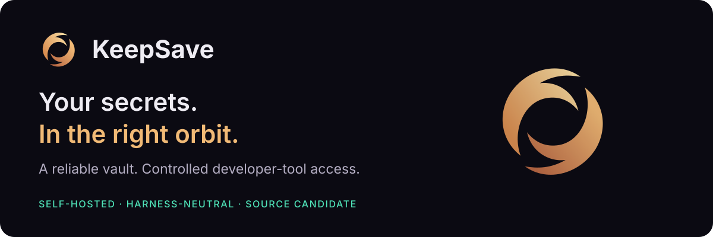

# KeepSave branding

The accepted product expression is **Event Horizon**, with the **Field Twist**
mark selected by the owner. This guide reconciles application assets and
new documentation artwork on 4 October 2026; it introduces no replacement logo.

## Assets and meaning

| Surface | Source of truth |
|---|---|
| Dark product surface | [Field Twist SVG](../frontend/public/keepsave.svg) |
| Light product surface | [Light Field Twist SVG](../frontend/public/keepsave-light.svg) |
| Browser icon | [Favicon SVG](../frontend/public/keepsave-favicon.svg) |
| App mark rendering | [EhMark](../frontend/src/components/cosmic/EhMark.tsx) |
| UI icons | [KeepSave icon family](../frontend/src/components/icons/) |
| Documentation header | [Header SVG](assets/keepsave-header.svg) |
| Prior illustrative banner | [September artwork and prompt](assets/keepsave-banner-prompt.md) |

Two curved light ribbons surround an open core. The form adapts black-hole and
polarization imagery into an abstract product mark; it is not a scientific
visualization. Preserve the ribbon geometry, open center, proportions and
warm-ivory/lavender relationship. Keep the name **KeepSave** and the tagline
**“Your secrets. In the right orbit.”**

The website's scientific inspiration does not establish encryption, custody,
compatibility or availability claims. Describe those from the current acceptance
ledger. The old cinematic banner is retained as historical artwork; the current
README uses the Field Twist SVG header.

## Tokens and readable surfaces

The application sources are [index.css](../frontend/src/index.css),
[cosmic.css](../frontend/src/styles/cosmic.css) and
[workspace.css](../frontend/src/styles/workspace.css). UI tokens use shared semantic light/dark values;
Gargantua uses explicit hex base colors, with optional accent variants. Documentation SVG uses these portable hex
approximations on an opaque dark ground:

| Role | Documentation value |
|---|---|
| Void background | `#0b0a12` |
| Opaque card | `#17141f` |
| Main text | `#eeecf3` |
| Secondary text | `#b4aec3` |
| Violet accent | `#a78bfa` |
| Mint signal | `#4fe3b8` |
| Warm ribbon | `#e7a566` → `#ffe2ad` |
| Cool ribbon | `#d6c9ff` → `#9680dc` |

Use Geist for UI/display and Geist Mono for data/code, with system fallbacks.
No font binaries are distributed with the diagrams. Static SVG keeps an opaque
canvas so the same image remains readable in GitHub's light and dark views.
The interactive architecture viewer has its own semantic light/dark controls.

DravenIQ inspires the task-focused design method: clear story, quiet product
surfaces, meaningful icons and honest states. KeepSave retains its own palette,
mark and type; DravenIQ's dragon and canonical cyan/blue tokens are not KeepSave
assets. Do not turn an ordinary workspace into decorative astronomy.

## Icons, copy and states

Use familiar silhouettes for folders, keys, members, history and controls.
The rounded orbital strokes may add identity while preserving immediate meaning.
An icon alone does not explain access denial, expiry, revocation or an unavailable
feature. Pair those states with text; distinguish **configured**, **locally
verified**, **externally qualified** and **operationally accepted** behavior.

Preserve visible labels, keyboard focus, icon-button accessible names, stable
interaction targets and reduced motion. Use status colors for their stated
meaning, with text alongside. Authorization comes from the server; a badge,
profile name, diagram or native client package cannot add permissions.

## Maintaining documentation visuals

Edit [the SVG generator](../scripts/gen_diagrams.py), then run
`python3 scripts/gen_diagrams.py`. It reads the accepted application mark and
writes all ten diagrams from any working directory. Do not independently repaint
checked-in SVGs. The header references the same source geometry; update it only
when an owner-approved mark changes.

The [architecture view guide](ARCHITECTURE_VIEWS.md) documents the source and
validation process for the interactive map. Brand consistency, structural
validation, browser behavior and owner acceptance remain separate checks.

## Gargantua landing study — 24 October 2026

The owner requested a new landing composition and palette inspired by Gargantua.
The [working storyboard](design/2026-10-24-gargantua/README.md) introduces a warmer
marketing expression: charcoal `#08090d`, ivory `#f5f1e8`, gold `#f4bf76`, quiet
surfaces and restrained violet `#b8a3ef`. Tokens are scoped to `.ks-landing`;
workspace, account and documentation palettes retain their own meanings.
Field Twist geometry and the familiar icon family stay unchanged.

The retained-violet statement above records the initial draft. The owner’s
25 October correction supersedes it for default interactive controls: selected
states, UAT accents, tool chips and glyphs now use gold/copper, with neutral
masked text. Status colors and explicitly chosen alternative accents remain
distinct. Large and legend planets share their stage paint rules.

This is a local design preview pending owner acceptance and publication. Original
black-hole artwork is conceptual; fictional feedback is visibly labeled. Neither
establishes scientific accuracy, real customers or accepted provider support.

## Application-wide Gargantua theme — 24 October 2026 follow-up

The owner expanded the selected landing direction to every application page and
requested the updated icon. `index.css` now supplies one shared palette for
workspace, accounts, dialogs, help and all other routes. Authentication surfaces
follow the same light/dark preference; their theme control preserves entered form
values. The separately scoped embedded widget has matching defaults and distinct
button foregrounds. The landing remains a deliberately dark marketing scene.

Field Twist's two ribbon silhouettes are unchanged. Dark paint is champagne/gold
and copper; light paint is deeper bronze/copper. The favicon adds a quiet charcoal
tile for small-size contrast. Shared icon detail inherits the warm accent while
status colors retain their meaning. Source images use cache version
`gargantua-field-twist-v3`.

The local trial uses synthetic data and a separately initialized PostgreSQL vault.
This does not establish provider setup, release acceptance or production deployment.
